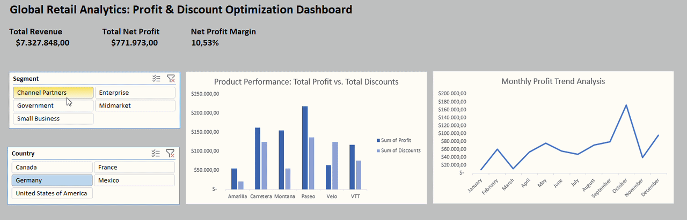

# Portfolio Project 1: Global Retail Performance & Margin Optimization

## 📊 Interactive Dashboard Demo

## 🎯 Business Problem
The executive leadership of a global retail corporation noticed fluctuations in profit margins across different international territories and customer segments. The goal of this analysis was to discover which segments are driving net profitability and where aggressive discounting is cannibalizing the bottom line.

## 🛠️ Tech Stack & Methodology
- **Tool:** Microsoft Excel (Advanced Pivot Tables, Trend Analysis, Dynamic KPI Cards, Interactive Slicers)
- **Data Transformation:** Consolidated global sales records, calculated dynamic Net Profit Margins (%), and designed a clean, corporate-ready Executive Dashboard for C-level decision-making.

## 🔍 Key Data Insights (USA & Small Business Analysis)
- **Healthy Profitability:** In the United States "Small Business" segment, the company operates at a solid **9.36% Net Profit Margin**, generating over **$1.07M in Net Profit** from **$11.45M in Revenue**.
- **Discount Efficiency:** Unlike lower-performing territories, the discount-to-profit ratio for high-volume products like "Paseo" and "VTT" is highly optimized in this segment, meaning discounts are successfully driving profitable volume rather than destroying margins.
- **Seasonality:** Profit trends experience a sharp dip around June-July but recover aggressively into Q4 (October peaks), signaling a strong year-end retail cycle.

## 💡 Strategic Recommendations for the CEO
1. **Replicate the US Small Business Model:** Use the pricing and discount thresholds applied in the US Small Business segment as a benchmark for lower-margin regions (like Canada/Germany).
2. **Q3 Operational Readiness:** Since profit heavily accelerates starting September, supply chain and marketing budgets should be aggressively allocated right before Q4 to capture the October peak.
